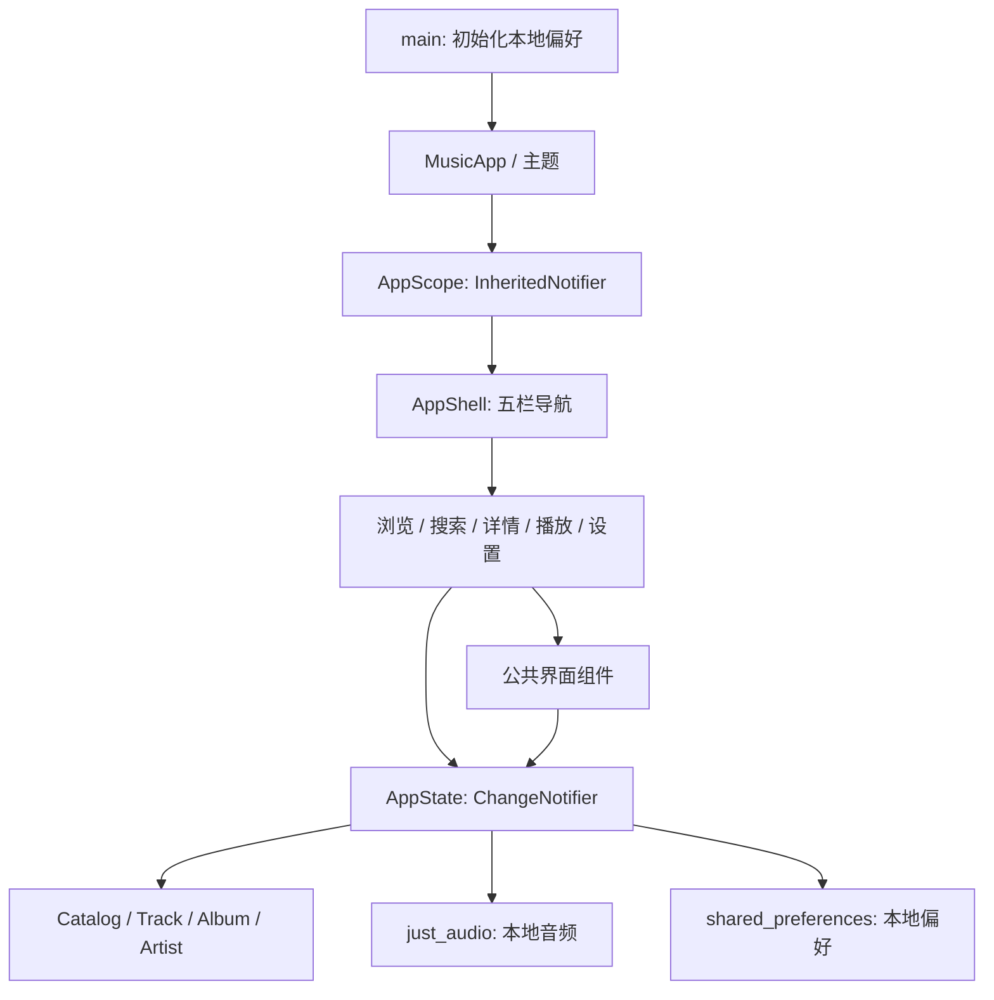

# 项目结构与架构说明

## 设计目标

以 Pixso 中的 9 个音乐界面为视觉参考，交付可运行、可浏览、可播放演示音频的 Flutter App。使用轻量的界面层、状态层和本地数据层，避免为当前规模引入额外的状态框架与路由框架。

## 目录结构

```text
MusicApp/
├── lib/
│   ├── main.dart                   # 启动、主题与 AppScope 注入
│   ├── core/
│   │   ├── app_state.dart          # 播放、队列、收藏、偏好及本地存储
│   │   └── theme.dart              # 颜色、Poppins 字体、明暗主题
│   ├── data/
│   │   └── catalog.dart            # Track / Album / Artist 模型与示例目录
│   ├── features/
│   │   ├── shell.dart              # 五栏导航与固定迷你播放器
│   │   ├── browse_pages.dart       # Home / Trending / Library
│   │   ├── search_page.dart        # 搜索、结果、空状态
│   │   ├── detail_pages.dart       # 专辑、歌手、完整歌曲列表
│   │   ├── player_page.dart        # 完整播放器及播放队列
│   │   └── settings_page.dart      # 邮箱、主题及音乐偏好
│   └── widgets/
│       └── music_widgets.dart     # 封面、横向列表、歌曲行、播放器等
├── assets/
│   ├── images/                    # 24 张经过压缩的 Pixso 封面
│   ├── fonts/                     # Poppins 四种字重及 OFL 许可证
│   └── audio/preview.m4a          # 原创合成演示音频
├── test/app_test.dart             # 状态、搜索与界面流程测试
├── integration_test/
│   └── app_flow_test.dart         # 真实设备流程与 18 张截图采集
├── test_driver/integration_test.dart # 接收并写入原生截图
├── scripts/capture_screenshots.sh # 截图入口
├── docs/
│   ├── ARCHITECTURE.md
│   ├── design/REFERENCE.md        # Pixso 节点及还原策略
│   └── screenshots/              # 两套主题 × 9 个界面
├── ios/                          # iOS Runner 工程
├── android/                      # Android 工程
├── web/                          # Web 启动工程
└── pubspec.yaml                  # 资源与依赖声明
```

## 层次与依赖



页面和公共组件从 `AppScope` 取得同一个 `AppState`。用户操作调用状态方法，状态通知后界面更新。播放位置由原生音频引擎的流驱动，不使用伪造进度计时器。

### 界面与导航

`AppShell` 用 `IndexedStack` 保留 Home、Trending、Search、Library 和 Settings 五个主页面的状态。专辑、歌手、完整播放器通过 `Navigator` 打开，返回时主页面仍保留原位置。详情页底部复用 `DetailDock`，主导航底部复用 `MiniPlayer`。

`Cover`、`AlbumRail`、`ArtistRail`、`TrackTile`、`SectionTitle` 等组件统一字号、间距与封面样式。蓝色背景纹理用 `CustomPainter` 绘制，底部导航凹口用 `CustomClipper` 绘制，减少对失效矢量导出资源的依赖。

### 状态与播放

`AppState` 负责当前曲目、播放/暂停、进度、队列、随机、单曲循环、收藏、关注、主题及偏好设置。使用 `just_audio` 播放随包携带的 `preview.m4a`，监听 `positionStream`、`playerStateStream` 与错误流。页面不各自创建音频播放器，因此迷你播放器和完整播放器可以保持同步。

切换曲目时更新元数据并将真实音频进度归零。来自专辑或搜索结果的播放操作可以建立对应队列。上一首/下一首在队列中循环，随机模式避免连续选中当前曲目，单曲循环交给音频引擎处理。启用 Autoplay 后，曲目结束会继续下一首。退出状态对象时释放播放器及订阅。

所有曲目共享一段原创演示音频；这是可验收音频交互的本地演示方案。接入真实曲库时，应为 `Track` 增加独立的音频资源或 URL，并在状态层替换音源加载逻辑。

### 数据与持久化

`Catalog` 是本地、只读的演示数据目录。搜索会去除首尾空格、忽略大小写，并检索歌曲名、歌手、曲风及示例专辑关键词。空查询返回空列表，无匹配显示明确的空状态。

`shared_preferences` 保存：

| 键 | 数据 |
| --- | --- |
| `dark` | 深色主题开关 |
| `favorites` | 收藏曲目 ID 列表 |
| `following` | 关注歌手列表 |
| `email` | 本地展示邮箱 |
| `offline` / `autoplay` / `normalisation` | 对应开关偏好 |
| `quality` | 音质滑块偏好 |

播放位置和临时队列保留在本次应用会话中。账户相关界面仅编辑本地展示邮箱；密码行会解释当前演示账户范围，不执行虚假的身份验证。

### 视觉与适配

浅色背景为白色，深色背景为 `#001B51`，主蓝为 `#477EFF`，强调粉为 `#FF4A70`。Poppins Regular、Medium、SemiBold 和 Bold 均本地打包。

列表采用横向或纵向滚动，网格采用两列布局，主体留白约 30 dp。主页面使用 `SafeArea`，底部播放器保留手势区域。播放器通过当前视口比例布置封面、进度条与控制区；控件保留标准点击区域。已经覆盖 393×852 与 320×568 的界面测试。

## 验证方式

1. `flutter analyze` 检查类型、导入与代码规范。
2. `flutter test` 验证搜索、持久化、队列与播放控制状态、主界面流程和紧凑屏幕布局。
3. `flutter drive` 在 iPhone 16e / iOS 26.0 模拟器验证原生音频进度，并覆盖全部 9 个页面与两套主题。
4. 集成测试通过 iOS 截图接口采集 PNG，由主机端驱动写入 `docs/screenshots/`。
5. 对主要截图进行视觉检查，确认封面、文字、底部导航和控制区正常显示。

实际测试结果与截图索引见项目根目录 README 和 `docs/screenshots/README.md`。Android 与 Web 工程已提供，此次没有运行验收记录。

## 后续接入位置

真实曲库、搜索与专辑详情可从 `Catalog` 替换为 repository 接口，页面继续消费相同的数据模型。网络音频、音频缓存和下载任务集中接入播放状态层。后台播放与锁屏媒体控制需单独引入对应服务与平台配置。登录、密码修改和跨设备收藏需要服务端认证与用户存储；当前本地邮箱不代表已登录身份。
