# 界面截图

截图来自运行中的 Flutter App：iPhone 16e 模拟器，iOS 26.0。两套主题各 9 张，共 18 张 1170×2532 PNG。

[浅色总览](overview-light.jpg) · [深色总览](overview-dark.jpg) · [主要界面预览](preview.jpg)

| 界面 | 浅色 | 深色 |
| --- | --- | --- |
| 01 探索主页 | 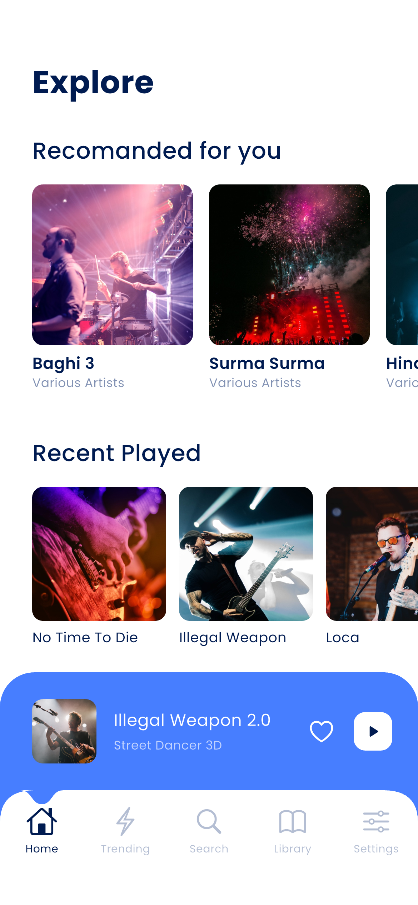 | 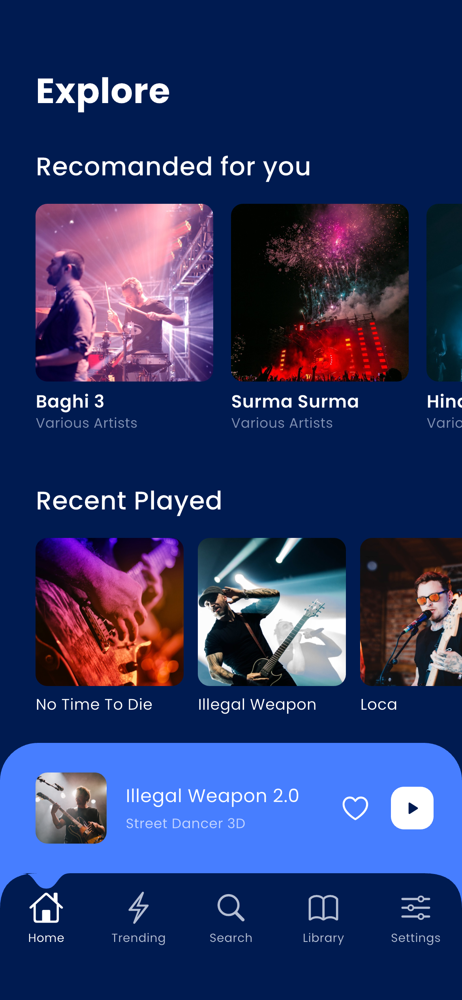 |
| 02 趋势 | 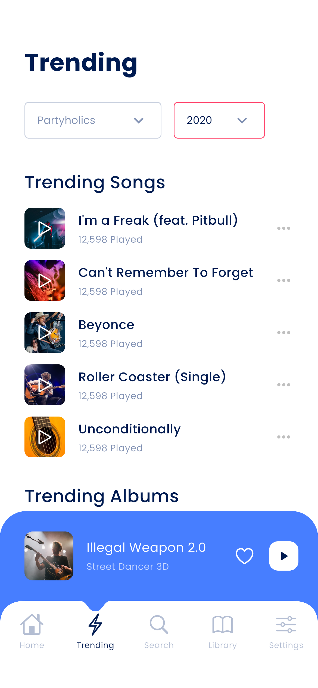 | 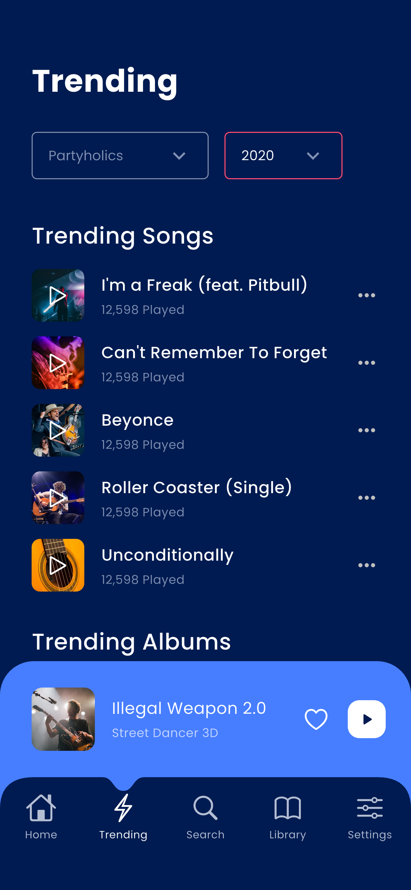 |
| 03 搜索 | 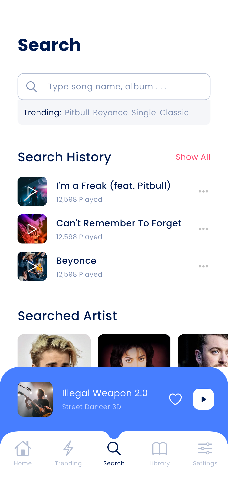 | 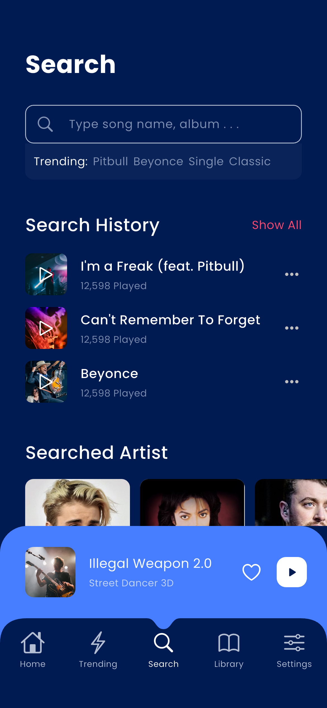 |
| 04 搜索结果 | 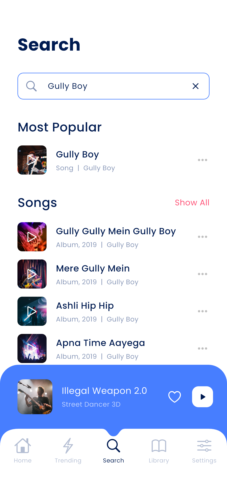 | 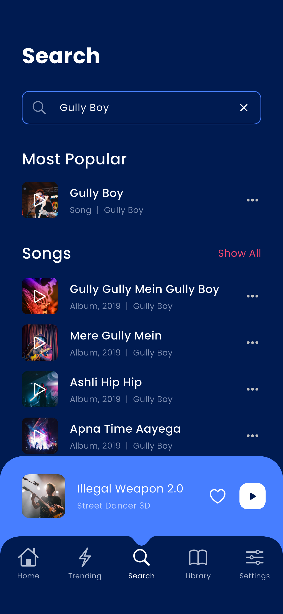 |
| 05 音乐库 | 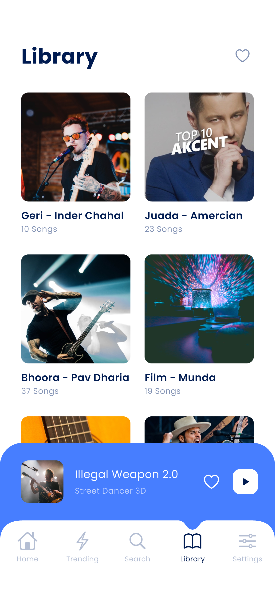 | 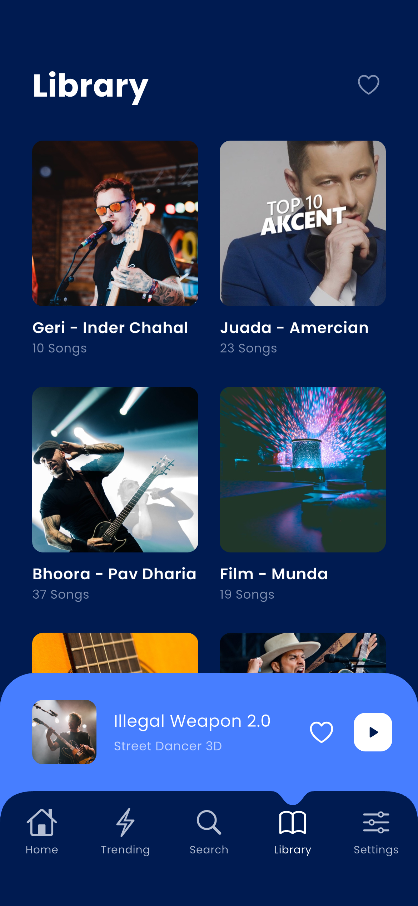 |
| 06 专辑 | 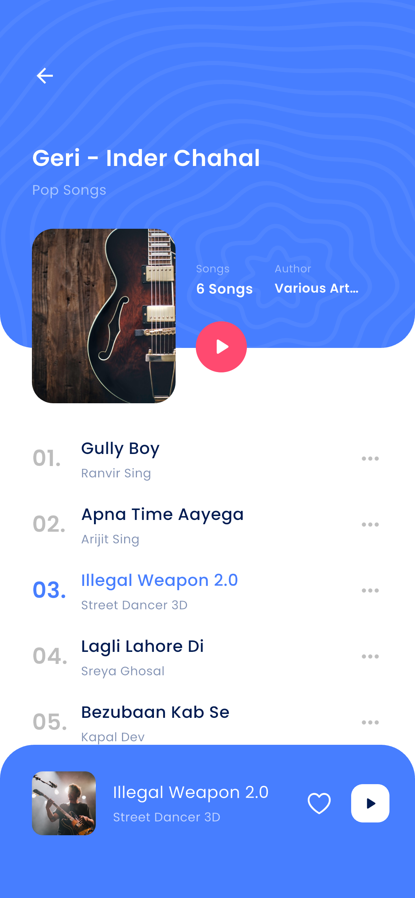 | 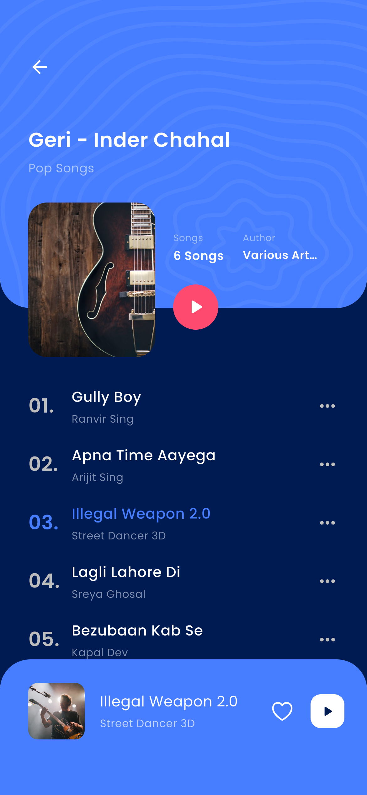 |
| 07 歌手 | 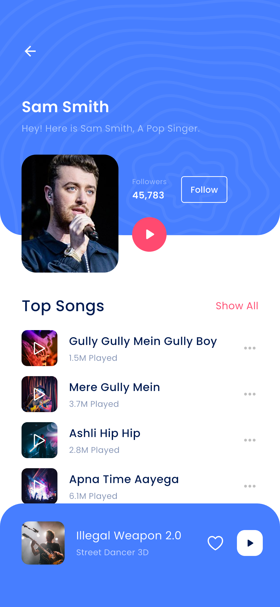 | 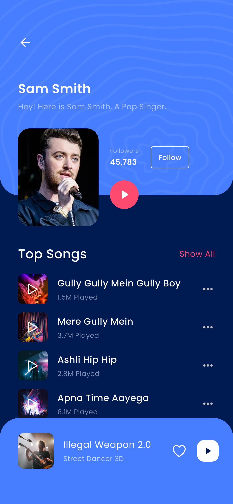 |
| 08 播放器 | 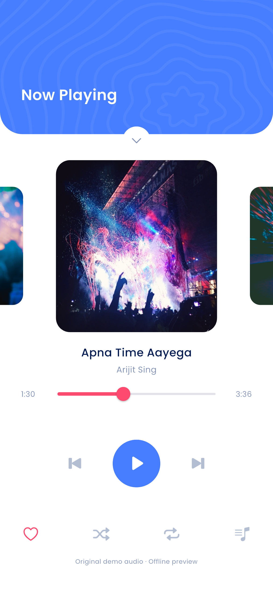 | 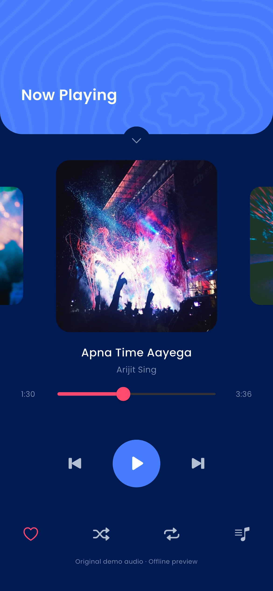 |
| 09 设置 | 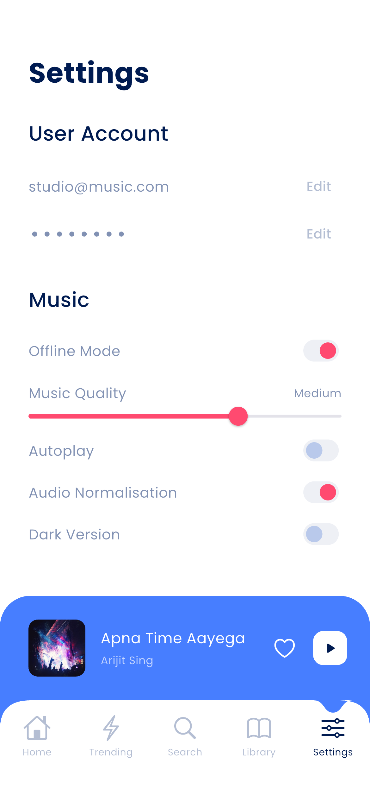 | 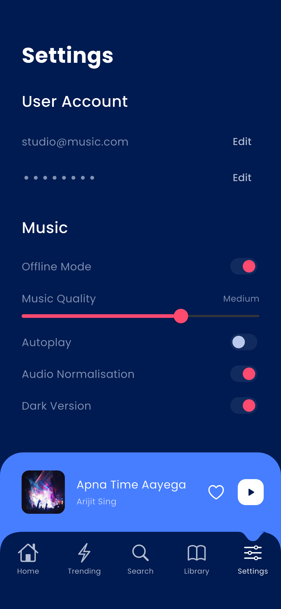 |

重新采集：在项目根目录执行 `./scripts/capture_screenshots.sh <simulator-id>`。为保证画面一致，集成测试会重置本应用的本地偏好。截图内容使用本地演示数据，播放器播放原创合成演示音频。
